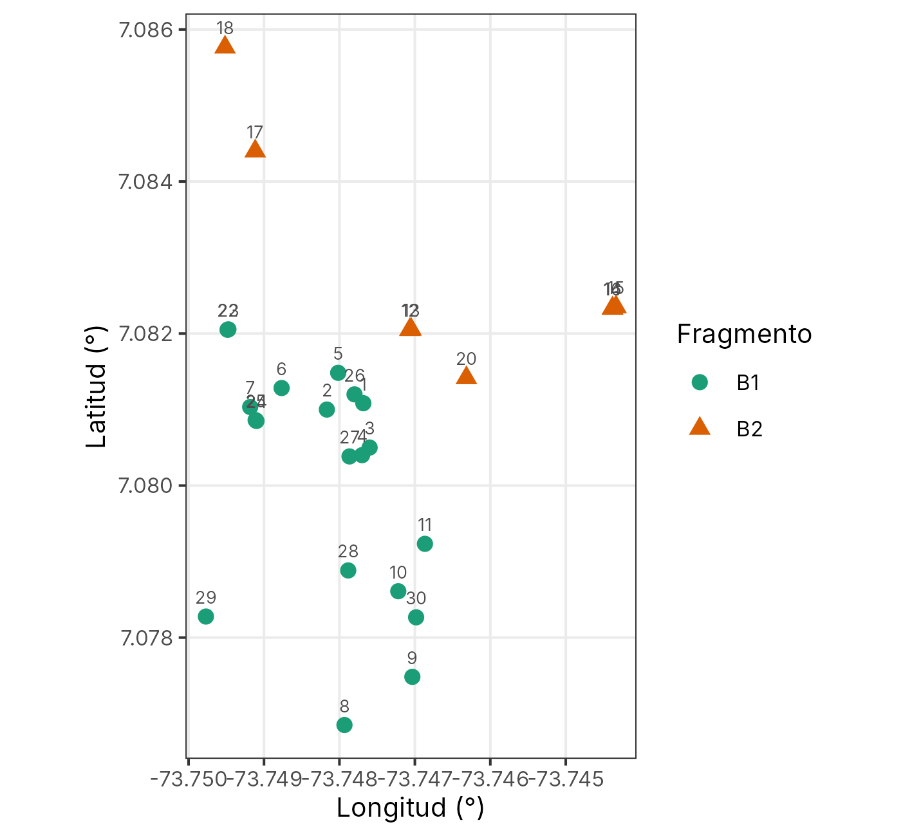
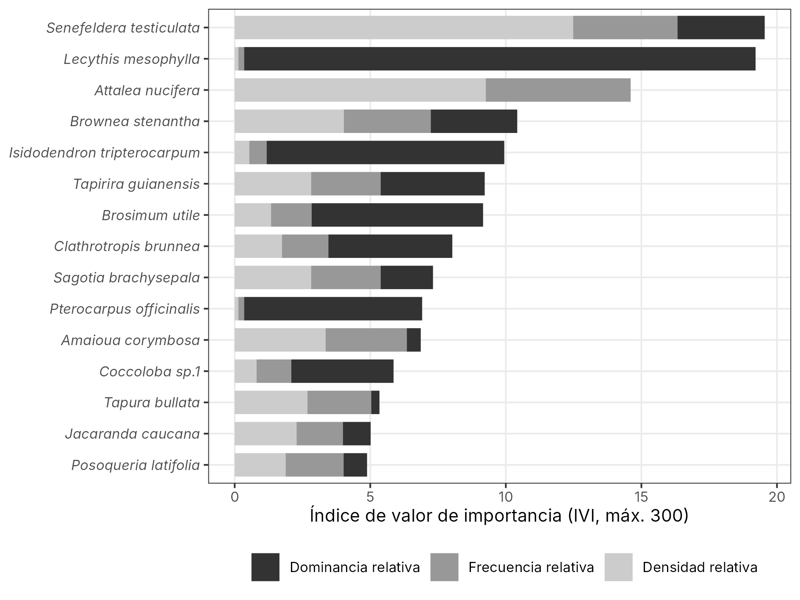
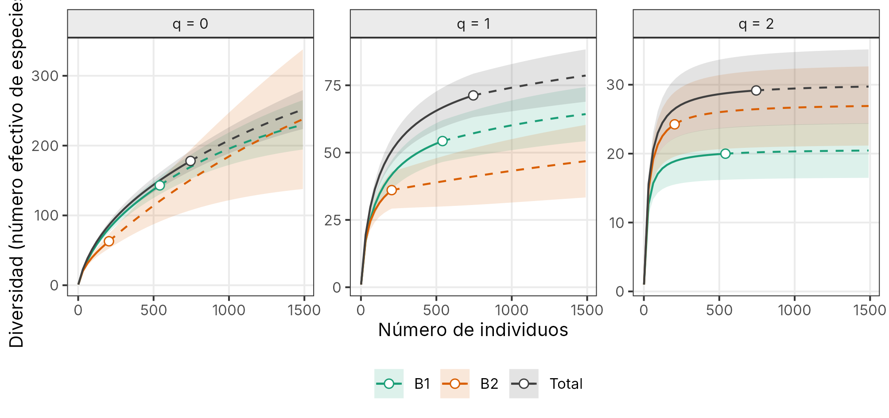
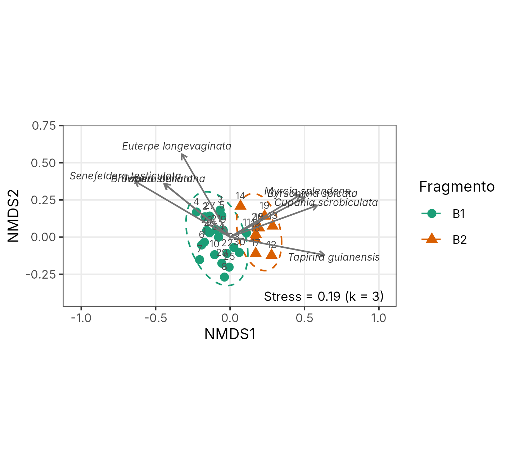
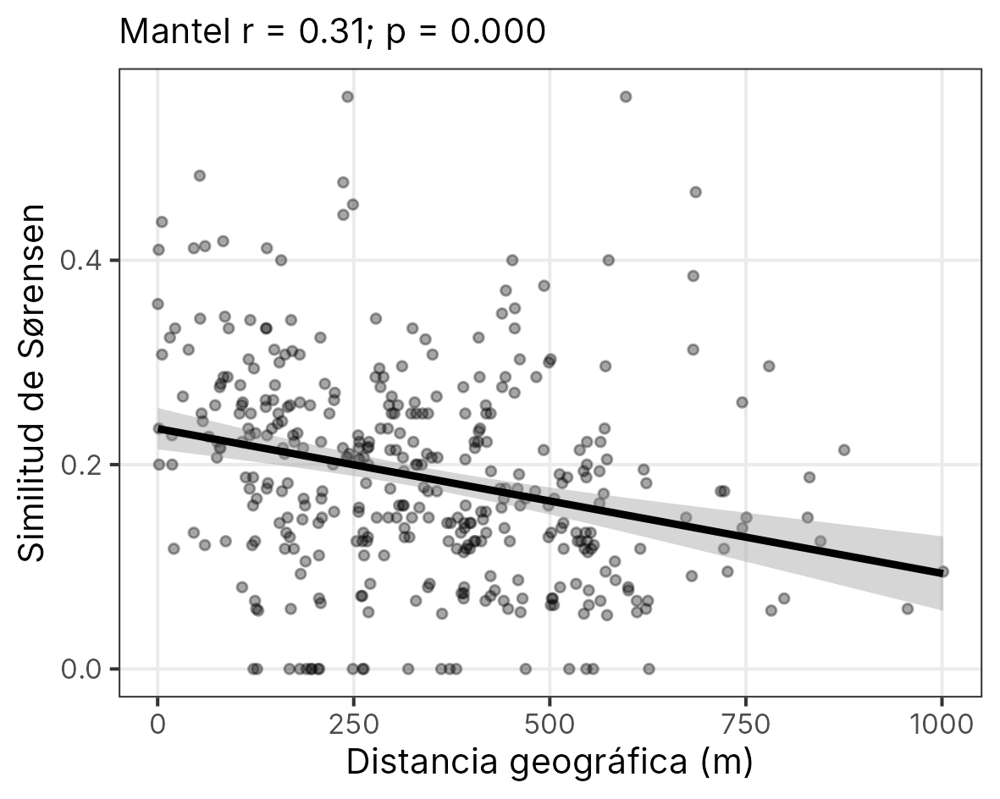
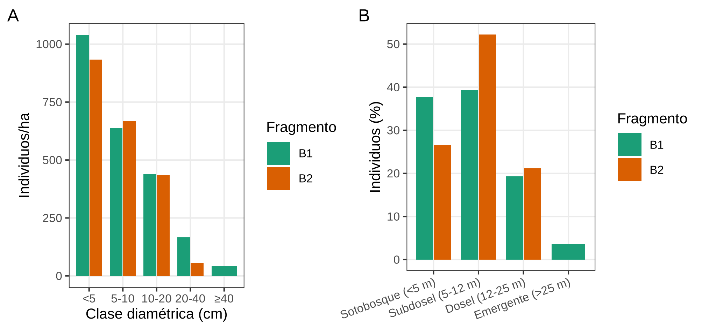

**Autores:** [POR COMPLETAR: nombre completo de cada autor, afiliación institucional, correo electrónico y ORCID; indicar autor de correspondencia]

# RESUMEN

Los bosques húmedos de tierras bajas del Magdalena Medio están entre los ecosistemas más transformados de Colombia y la información cuantitativa sobre su diversidad a escala local es escasa. Describimos la composición, diversidad alfa y beta y la estructura de los relictos de bosque del Instituto Universitario de la Paz en Barrancabermeja, Santander. En 30 transectos de 100 m^2^ (0,3 ha) distribuidos en dos fragmentos medimos todos los individuos leñosos con DAP ≥ 2,5 cm y analizamos la diversidad con números de Hill, rarefacción y extrapolación, partición de la diversidad beta y PERMANOVA. Registramos 745 individuos de 178 morfoespecies, 100 géneros y 42 familias. *Senefeldera testiculata*, *Lecythis mesophylla* y *Attalea nucifera* tuvieron el mayor valor de importancia, y Fabaceae fue la familia más importante y más rica. La cobertura de muestreo fue 0,87, pero la riqueza estimada duplicó la observada, lo que indica una alta proporción de especies raras. La diversidad beta fue alta y se debió casi por completo al recambio de especies, que aumentó con la distancia entre transectos; los dos fragmentos difirieron en composición y en área basal, aunque no en densidad ni en diversidad por transecto. La distribución diamétrica en J invertida y la concentración del área basal en pocos árboles grandes sugieren bosques en recuperación con remanentes del dosel original. Estos relictos conservan una flora rica con afinidades amazónicas y chocoanas, y su protección es relevante para la conservación regional.

**Palabras clave:** diversidad beta, números de Hill, recambio de especies, relictos boscosos, Santander

# ABSTRACT

Lowland moist forests of the Middle Magdalena valley are among the most transformed ecosystems of Colombia, and quantitative information on their local diversity is scarce. We describe the composition, alpha and beta diversity and structure of the forest remnants of the Instituto Universitario de la Paz in Barrancabermeja, Santander. In 30 transects of 100 m^2^ (0.3 ha) located in two fragments we measured all woody individuals with DBH ≥ 2.5 cm and analysed diversity with Hill numbers, rarefaction and extrapolation, beta diversity partitioning and PERMANOVA. We recorded 745 individuals of 178 morphospecies, 100 genera and 42 families. *Senefeldera testiculata*, *Lecythis mesophylla* and *Attalea nucifera* had the highest importance values, and Fabaceae was the most important and species-rich family. Sample coverage was 0.87, but estimated richness doubled observed richness, indicating a high proportion of rare species. Beta diversity was high and almost entirely due to species turnover, which increased with distance between transects; the two fragments differed in composition and basal area, but not in density or diversity per transect. The reverse-J diameter distribution and the concentration of basal area in a few large trees suggest recovering forests that retain remnants of the original canopy. These remnants hold a rich flora with Amazonian and Chocoan affinities, and their protection is relevant for regional conservation.

**Keywords:** beta diversity, forest remnants, Hill numbers, Santander, species turnover

# INTRODUCCIÓN

Los bosques tropicales de tierras bajas concentran la mayor riqueza de plantas leñosas del planeta, y en el Neotrópico esa riqueza varía con la precipitación, la estacionalidad y la fertilidad del suelo (Gentry, 1982; 1988). Comprender cómo se distribuye la diversidad dentro de un paisaje requiere separar la diversidad local, o alfa, del cambio en composición entre sitios, o beta, porque ambos componentes responden a procesos distintos como la limitación de la dispersión y la heterogeneidad ambiental (Condit et al., 2002; Tuomisto et al., 2003).

El valle medio del río Magdalena fue cubierto por bosques húmedos que conectaban floras del Chocó, la Amazonia y Centroamérica. Durante el último siglo la expansión ganadera, petrolera y agrícola redujo estos bosques a relictos aislados (Etter et al., 2008), y la fragmentación altera la composición, la estructura y la dinámica de los bosques remanentes (Laurance et al., 2002). Pese a ello, los inventarios cuantitativos de la vegetación leñosa en la región son pocos y rara vez usan métodos que permitan comparar la diversidad entre sitios con esfuerzos de muestreo distintos [POR COMPLETAR: citar inventarios previos del Magdalena Medio y de Santander].

Los números de Hill expresan la diversidad como número efectivo de especies y permiten comparar riqueza, diversidad de Shannon y de Simpson en una misma escala (Hill, 1973; Jost, 2006). Combinados con rarefacción y extrapolación basadas en tamaño de muestra y en cobertura, permiten comparar comunidades muestreadas de forma incompleta sin sesgos por el esfuerzo (Chao & Jost, 2012; Chao et al., 2014). A su vez, la partición de la diversidad beta en recambio y anidamiento indica si las diferencias entre sitios se deben al reemplazo de especies o a la pérdida de especies en sitios más pobres (Baselga, 2010).

En este trabajo describimos los patrones de diversidad de los relictos de bosque húmedo tropical del Instituto Universitario de la Paz (UNIPAZ), en Barrancabermeja. Nos preguntamos (1) cuáles son la composición florística y las especies y familias dominantes, (2) qué tan completa es la muestra y cuál es la diversidad alfa estimada, (3) cuánto cambia la composición entre transectos y entre fragmentos y si ese cambio se debe al recambio o al anidamiento, y (4) cómo es la estructura horizontal y vertical de estos bosques.

# MATERIALES Y MÉTODOS

## Área de estudio

El estudio se realizó en los relictos boscosos del predio del Instituto Universitario de la Paz, UNIPAZ (finca Santa Lucía), en el municipio de Barrancabermeja, Santander, Colombia, aproximadamente a 7º04'N, 73º45'W y entre 106 y 127 m de altitud (Fig. 1). La zona corresponde a bosque húmedo tropical según Holdridge (1967), con temperatura media cercana a 28 ºC y precipitación anual de [POR COMPLETAR: precipitación media anual y régimen, con fuente IDEAM]. El muestreo se hizo en dos fragmentos de bosque, denominados B1 y B2, separados [POR COMPLETAR: distancia, área de cada fragmento, historia de uso y matriz circundante].

## Muestreo de la vegetación

Entre abril de 2012 y octubre de 2013 se establecieron 30 transectos de 100 m^2^ [POR COMPLETAR: dimensiones, p. ej. 2 × 50 m], 21 en B1 y nueve en B2, para un área total de 0,3 ha. En cada transecto se registraron todos los individuos leñosos con diámetro a la altura del pecho, DAP, de al menos 2,5 cm [POR COMPLETAR: confirmar criterio de inclusión; el menor DAP registrado fue 2,3 cm]. Se midió la circunferencia a la altura del pecho de cada tallo y se estimó la altura total. Para los individuos con varios tallos se calculó un DAP equivalente como la raíz cuadrada de la suma de los cuadrados de los DAP de los tallos, y el área basal como la suma de las áreas basales de cada tallo. *Attalea nucifera* es una palma acaule, y en ella se midieron pecíolos y no tallos; por ello sus individuos se incluyeron en los análisis de composición y diversidad, pero no en los de DAP y área basal. Se tomaron coordenadas geográficas del inicio de cada transecto.

Se recolectaron muestras botánicas de los individuos, que fueron identificadas con claves taxonómicas, comparación con material de herbario y consulta a especialistas. Los ejemplares de respaldo se depositaron en [POR COMPLETAR: herbario y acrónimo según Index Herbariorum]. La nomenclatura sigue el Catálogo de plantas y líquenes de Colombia (Bernal et al., 2016). Los individuos que no pudieron identificarse a especie se trataron como morfoespecies. La recolección se realizó conforme a la normatividad nacional vigente [POR COMPLETAR: permiso de recolección].

## Análisis de datos

**Composición.** Para cada especie se calculó el índice de valor de importancia, IVI, como la suma de la densidad, la frecuencia y la dominancia relativas (Curtis & McIntosh, 1951). Para cada familia se calculó el índice de valor de importancia familiar, IVF, como la suma de la densidad, la diversidad y la dominancia relativas (Mori et al., 1983).

**Diversidad alfa.** La diversidad se expresó con números de Hill de orden q = 0 (riqueza de especies), q = 1 (exponencial de la entropía de Shannon) y q = 2 (inverso del índice de Simpson) (Hill, 1973; Jost, 2006). Para el bosque en conjunto y para cada fragmento se construyeron curvas de rarefacción y extrapolación basadas en abundancia hasta el doble del tamaño de la muestra total, con intervalos de confianza del 95 % obtenidos con 200 réplicas de bootstrap (Chao et al., 2014). La completitud del inventario se evaluó con la cobertura de muestreo (Chao & Jost, 2012) y con los estimadores asintóticos de riqueza Chao1 (Chao, 1984), de diversidad de Shannon (Chao et al., 2013) y de Simpson. Los fragmentos se compararon a un mismo tamaño de muestra, igual al número de individuos del fragmento más pequeño, y a una misma cobertura, igual a la menor de las coberturas alcanzadas al doble de cada muestra (Chao et al., 2014); se consideraron diferentes cuando los intervalos de confianza no se superpusieron. Como complemento se usaron los transectos como unidades de muestreo para calcular los estimadores de incidencia Chao2 y jackknife de primer y segundo orden (Colwell & Coddington, 1994). Para cada transecto se calcularon la riqueza, la abundancia, los números de Hill, la equidad de Pielou, el alfa de Fisher (Fisher et al., 1943) y el área basal, y los fragmentos se compararon con pruebas de Wilcoxon.

**Diversidad beta.** Con datos de presencia y ausencia se calculó la disimilitud multisitio de Sørensen, βSOR, y su partición en recambio, βSIM, y anidamiento, βSNE (Baselga, 2010). Para comparar fragmentos con igual número de sitios, en el bosque total y en B1 se promediaron 200 submuestras aleatorias de nueve transectos, el número de transectos de B2. También se calculó la diversidad beta de Whittaker como la razón entre la riqueza total y la riqueza media por transecto. Las diferencias en composición entre fragmentos se evaluaron con PERMANOVA (Anderson, 2001) sobre las distancias de Bray-Curtis (abundancia) y de Sørensen (incidencia), con 9999 permutaciones, y la homogeneidad de la dispersión multivariada con betadisper (Anderson, 2006). La composición se ordenó con escalamiento multidimensional no métrico, NMDS, en tres dimensiones sobre la distancia de Bray-Curtis (Clarke, 1993), y se ajustaron como vectores las especies presentes en al menos cinco transectos. La relación entre la disimilitud florística y la distancia geográfica se evaluó con pruebas de Mantel con correlación de Spearman y 9999 permutaciones (Nekola & White, 1999), usando los 28 transectos con coordenadas.

**Estructura.** Se calcularon la densidad, en individuos por hectárea, y el área basal, en m^2^ por hectárea. Excluyendo a *A. nucifera*, los individuos se agruparon en clases diamétricas de <5, 5-10, 10-20, 20-40 y ≥40 cm, y a la distribución se ajustó un modelo exponencial negativo para calcular el cociente de De Liocourt (Meyer, 1952). Las distribuciones diamétricas de los fragmentos se compararon con la prueba de Kolmogorov-Smirnov. Los individuos se asignaron a cuatro estratos de altura: sotobosque (<5 m), subdosel (5-12 m), dosel (12-25 m) y emergentes (>25 m). Se ajustó una relación alométrica log-log entre altura y DAP excluyendo las palmas. Cuatro alturas inverosímiles, con una relación altura/DAP mayor a 400, se excluyeron de los análisis de estructura vertical.

**Afinidades biogeográficas.** Para las especies identificadas se registró su presencia en las regiones naturales de Colombia y en Centroamérica a partir del Catálogo de plantas y líquenes de Colombia (Bernal et al., 2016), Tropicos (Tropicos.org, 2026) y los registros de GBIF (GBIF.org, 2026), y se calculó el porcentaje de especies compartidas con cada región.

Todos los análisis se hicieron en R 4.3.3 (R Core Team, 2024) con el paquete vegan 2.6-4 (Oksanen et al., 2022). Las funciones de rarefacción y extrapolación de números de Hill se programaron siguiendo a Chao et al. (2014) y se verificaron contra los valores publicados por Hsieh et al. (2016). Los datos y el código están disponibles en [POR COMPLETAR: repositorio público].

# RESULTADOS

## Composición florística

Se registraron 745 individuos pertenecientes a 178 morfoespecies, 100 géneros y 42 familias (Tabla 1, Anexo 1). Del total de morfoespecies, 104 (58 %) se identificaron a especie, 34 a género, 27 a familia y 13 quedaron indeterminadas. Las familias más ricas fueron Fabaceae con 25 especies, Moraceae y Annonaceae con 12 cada una, Rubiaceae con ocho, y Malvaceae y Violaceae con siete. Las familias con más individuos fueron Euphorbiaceae (121), Arecaceae (90) y Fabaceae (78).

*Senefeldera testiculata* fue la especie con mayor IVI (19,5), por su alta densidad (93 individuos, 12,5 % del total) y frecuencia (18 transectos). Le siguieron *Lecythis mesophylla* (19,2), representada por un solo árbol de 159 cm de DAP que aportó el 18,9 % del área basal, y *A. nucifera* (14,6), la especie más frecuente, con 69 individuos en 25 transectos (Fig. 2). Completaron las diez primeras *Brownea stenantha*, *Isidodendron tripterocarpum*, *Tapirira guianensis*, *Brosimum utile*, *Clathrotropis brunnea*, *Sagotia brachysepala* y *Pterocarpus officinalis*. Fabaceae tuvo el mayor IVF (44,1), seguida por Lecythidaceae (27,4), Euphorbiaceae (24,0), Moraceae (22,7) y Arecaceae (16,7) (Tabla 2).

La flora estuvo dominada por especies raras: 94 especies (53 %) se registraron con un solo individuo, 24 con dos individuos, y 100 especies (56 %) aparecieron en un solo transecto.

## Diversidad alfa

La cobertura de muestreo del bosque fue 0,87, es decir, cerca del 13 % de los individuos de la comunidad pertenecen a especies no registradas. Sin embargo, la riqueza estimada con Chao1 fue de 362 especies (IC 95 %: 280-444), por lo que el inventario registró cerca de la mitad de la riqueza esperada (Tabla 1). Los estimadores de incidencia dieron valores similares: Chao2 = 339 ± 45 y jackknife de segundo orden = 341. En contraste, la diversidad de Shannon observada (71,2 especies efectivas) alcanzó el 78 % de su valor asintótico (91,1) y la de Simpson (29,2) el 96 % (30,3), lo que indica que las especies comunes están bien representadas y que el déficit se concentra en las raras (Fig. 3).

A un mismo tamaño de muestra de 204 individuos, B1 tuvo mayor riqueza que B2 (81,2 frente a 63,0 especies; intervalos sin superposición), una diversidad de Shannon similar (41,8 frente a 36,1) y menor diversidad de Simpson (18,9 frente a 24,3), aunque en este último caso los intervalos se superpusieron ligeramente. La comparación a igual cobertura (0,83) mostró el mismo patrón: B1 superó a B2 en riqueza (123 frente a 99 especies) y B2 tendió a superar a B1 en diversidad de orden 2 (25,7 frente a 19,8) (Fig. 3). En B2 solo dos especies tuvieron dos individuos, por lo que su riqueza asintótica es muy incierta (Chao1 = 422; IC 95 %: 81-763) y no debe interpretarse; la extrapolación al doble de la muestra es más confiable (Chao et al., 2014). Esto indica que B1 tiene más especies raras pero una mayor dominancia de pocas especies, principalmente *S. testiculata* y *A. nucifera*.

Por transecto se registraron en promedio 24,8 ± 6,9 individuos y 15,6 ± 4,0 especies, con una diversidad de Shannon de 2,51 ± 0,33 y una equidad de 0,93 ± 0,05. Ninguna de estas variables difirió entre fragmentos (Wilcoxon, p > 0,09), pero el área basal por transecto fue mayor en B1 (mediana de 0,32 m^2^ frente a 0,10 m^2^; W = 149, p = 0,015).

## Diversidad beta

La disimilitud multisitio entre nueve transectos fue muy alta (βSOR = 0,89) y se debió casi por completo al recambio de especies (βSIM = 0,87), mientras que el anidamiento fue mínimo (βSNE = 0,02); el recambio explicó el 98 % de la diversidad beta (Tabla 3). El patrón fue similar dentro de cada fragmento (βSOR = 0,88 en B1 y 0,85 en B2, con 97 % y 96 % de recambio). La riqueza total fue 11,4 veces la riqueza media por transecto, y en promedio dos transectos compartieron solo el 19 % de sus especies (βSOR por pares = 0,81).

Los fragmentos compartieron 28 especies; 115 fueron exclusivas de B1 y 35 de B2, con una similitud de Sørensen de 0,27. La composición difirió entre fragmentos tanto en abundancia (PERMANOVA Bray-Curtis: F = 6,29, R^2^ = 0,18, p < 0,001) como en incidencia (Sørensen: F = 6,18, R^2^ = 0,18, p < 0,001). La dispersión multivariada fue homogénea con Bray-Curtis (p = 0,39), por lo que la diferencia refleja un cambio real en composición; con Sørensen B2 fue menos disperso (p = 0,009). La similitud media de Bray-Curtis entre transectos del mismo fragmento fue más del doble que entre fragmentos (0,25 frente a 0,10). En el NMDS (estrés = 0,19) los transectos de B1 se asociaron con *S. testiculata*, *Euterpe longevaginata*, *Tapura bullata* y *B. stenantha*, y los de B2 con *T. guianensis*, *Cupania scrobiculata*, *Byrsonima spicata* y *Myrcia splendens* (Fig. 4a). La disimilitud florística aumentó con la distancia entre transectos, en un intervalo de hasta 1 km (Mantel Bray-Curtis: r = 0,36, p < 0,001; Sørensen: r = 0,31, p < 0,001) (Fig. 4b).

## Estructura

La densidad fue de 2483 individuos/ha y el área basal de 35,2 m^2^/ha. B1 y B2 tuvieron densidades similares (2576 y 2267 individuos/ha), pero el área basal de B1 (44,6 m^2^/ha) fue más del triple que la de B2 (13,2 m^2^/ha) (Tabla 1). Sin *A. nucifera*, la distribución diamétrica de los 676 individuos restantes tuvo forma de J invertida (Fig. 5a): el 44,7 % tuvo DAP < 5 cm, el 28,7 % entre 5 y 10 cm, el 19,4 % entre 10 y 20 cm, el 5,9 % entre 20 y 40 cm y el 1,3 % ≥ 40 cm. El modelo exponencial negativo se ajustó bien (ln N = 6,98 − 0,062 DAP; R^2^ = 0,99) con un cociente de De Liocourt de 2,7. Solo nueve árboles con DAP ≥ 40 cm concentraron el 47,6 % del área basal. La distribución diamétrica no difirió entre fragmentos (Kolmogorov-Smirnov: D = 0,07, p = 0,46), aunque los árboles mayores de 20 cm fueron más frecuentes en B1.

Verticalmente, el 34,7 % de los individuos estuvo en el sotobosque, el 42,9 % en el subdosel, el 19,8 % en el dosel y el 2,6 % fueron emergentes de más de 25 m (Fig. 5b). B2 tuvo una mayor proporción de individuos en el subdosel (52 % frente a 39 %) y no tuvo emergentes, que en B1 representaron el 3,5 %. El sotobosque estuvo dominado por *S. testiculata* y *A. nucifera*, el subdosel por *S. testiculata*, *B. stenantha* y *A. corymbosa*, y el dosel por *T. guianensis*, *B. stenantha* y *B. spicata*. Los árboles más altos fueron *L. mesophylla* (33 m), *Tetragastris panamensis* e *I. tripterocarpum* (30 m). La altura se relacionó con el DAP según ln H = 0,59 + 0,74 ln DAP (R^2^ = 0,71; n = 651).

## Afinidades biogeográficas

De las 56 especies con información de distribución, el 79 % se registra también en la Amazonia, el 73 % en el Chocó biogeográfico, el 64 % en Centroamérica y el 59 % en los Andes; las afinidades con la Orinoquia (50 %), el valle del Cauca (43 %), el Caribe (32 %) y la Guayana (12 %) fueron menores. *Eugenia floribunda*, *Guatteria* cf. *goudotiana* e *I. tripterocarpum* solo se registran en el valle del Magdalena.

# DISCUSIÓN

El bosque de UNIPAZ alberga una flora leñosa rica para el área muestreada. Con 178 morfoespecies en 0,3 ha y una riqueza estimada de más de 300 especies, la diversidad es alta, aunque las comparaciones con otros inventarios deben hacerse con cautela porque nuestro criterio de inclusión (DAP ≥ 2,5 cm) y área son similares, pero no idénticos, a los de los transectos de 0,1 ha de Gentry (Phillips & Miller, 2002) [POR COMPLETAR: comparar con la riqueza de transectos Gentry en bosques húmedos de tierras bajas de Colombia y del Magdalena Medio]. La riqueza por transecto y la alta equidad indican que, a escala de 100 m^2^, casi cada individuo pertenece a una especie distinta, un rasgo típico de bosques húmedos tropicales de tierras bajas (Gentry, 1988).

La combinación de alta cobertura de muestreo y baja completitud de la riqueza tiene una lectura clara: las especies comunes ya están bien caracterizadas, mientras que más de la mitad de las especies son raras y muchas aún no se han registrado. Los números de Hill de orden 1 y 2 están cerca de sus valores asintóticos, de modo que las conclusiones sobre dominancia y diversidad de especies comunes son robustas, mientras que la riqueza total debe interpretarse como una estimación mínima (Chao et al., 2014). Ampliar el muestreo, en particular en B2, mejoraría la estimación de la riqueza.

La importancia de *S. testiculata* y de las palmas *A. nucifera*, *Astrocaryum malybo* y *E. longevaginata* en el sotobosque y el subdosel, junto con la de *B. stenantha*, *T. guianensis* y *C. brunnea*, define la fisonomía de este bosque. La dominancia de pocas especies de sotobosque contrasta con un dosel en el que el área basal depende de individuos aislados de gran tamaño, como *L. mesophylla*, *I. tripterocarpum*, *Pterocarpus officinalis* y *B. utile*. Que Fabaceae sea la familia más rica e importante concuerda con el patrón general de los bosques neotropicales de tierras bajas (Gentry, 1988).

El resultado más destacado es la magnitud del recambio de especies. Con un 98 % de la diversidad beta debida al reemplazo de especies y casi sin anidamiento, los transectos no son subconjuntos empobrecidos unos de otros, sino muestras de una flora muy heterogénea. El decaimiento de la similitud con la distancia en una escala de solo 1 km sugiere que la limitación de la dispersión, la heterogeneidad ambiental local o ambas estructuran la composición (Condit et al., 2002; Tuomisto et al., 2003). Parte de este recambio puede deberse también al gran número de especies raras, que inflan la disimilitud entre muestras pequeñas; por ello, la diferencia entre fragmentos se confirmó con medidas basadas en abundancia y con dispersión homogénea.

Los dos fragmentos difieren en composición y en estructura más que en diversidad local. B1 tiene más especies, más área basal y árboles emergentes, mientras que B2 tiene un subdosel denso, sin emergentes, y especies como *T. guianensis*, *B. spicata*, *C. scrobiculata* y *M. splendens*, asociadas con frecuencia a bosques secundarios o de borde [POR COMPLETAR: cita sobre ecología de estas especies]. Este contraste sugiere historias de perturbación distintas, con B2 en una etapa sucesional más temprana o con mayor extracción de árboles grandes [POR COMPLETAR: confirmar historia de uso de cada fragmento]. La mayor diversidad de Simpson en B2 refleja una menor dominancia de *S. testiculata*, no una mayor riqueza.

La distribución en J invertida indica una regeneración activa, y la concentración del área basal en pocos árboles grandes muestra que estos relictos conservan remanentes del dosel original. Esos árboles son críticos: su pérdida reduciría a la mitad la biomasa del bosque, y la fragmentación aumenta su mortalidad (Laurance et al., 2002).

Las afinidades florísticas con la Amazonia, el Chocó y Centroamérica reflejan la posición del Magdalena Medio como corredor entre floras de tierras bajas, y la presencia de especies restringidas al valle del Magdalena, como *I. tripterocarpum*, resalta su valor para la conservación regional. En un paisaje transformado por la ganadería y la actividad petrolera (Etter et al., 2008), los relictos de UNIPAZ funcionan como reservorio de diversidad y como sitio para la investigación y la educación ambiental. Recomendamos mantener su conectividad, evitar la extracción de árboles grandes y establecer parcelas permanentes que permitan seguir su dinámica.

# PARTICIPACIÓN DE AUTORES

[POR COMPLETAR: iniciales y contribución de cada autor, p. ej. "AJ, concepción, diseño, toma de datos e identificación; XX, análisis de datos; AJ, XX, escritura del documento".]

# AGRADECIMIENTOS

[POR COMPLETAR: agradecimientos, por ejemplo a Oscar Garzón y Diego Cabrera por su apoyo en campo, a los especialistas que identificaron material, al herbario y a UNIPAZ.]

# CONFLICTO DE INTERESES

Los autores declaran que no tienen conflicto de intereses.

# LITERATURA CITADA

Anderson, M. J. (2001). A new method for non-parametric multivariate analysis of variance. *Austral Ecology*, *26*(1), 32-46. https://doi.org/10.1111/j.1442-9993.2001.01070.pp.x

Anderson, M. J. (2006). Distance-based tests for homogeneity of multivariate dispersions. *Biometrics*, *62*(1), 245-253. https://doi.org/10.1111/j.1541-0420.2005.00440.x

Baselga, A. (2010). Partitioning the turnover and nestedness components of beta diversity. *Global Ecology and Biogeography*, *19*(1), 134-143. https://doi.org/10.1111/j.1466-8238.2009.00490.x

Bernal, R., Gradstein, S. R. & Celis, M. (Eds.). (2016). *Catálogo de plantas y líquenes de Colombia*. Instituto de Ciencias Naturales, Universidad Nacional de Colombia.

Chao, A. (1984). Nonparametric estimation of the number of classes in a population. *Scandinavian Journal of Statistics*, *11*(4), 265-270.

Chao, A., Gotelli, N. J., Hsieh, T. C., Sander, E. L., Ma, K. H., Colwell, R. K. & Ellison, A. M. (2014). Rarefaction and extrapolation with Hill numbers: a framework for sampling and estimation in species diversity studies. *Ecological Monographs*, *84*(1), 45-67. https://doi.org/10.1890/13-0133.1

Chao, A. & Jost, L. (2012). Coverage-based rarefaction and extrapolation: standardizing samples by completeness rather than size. *Ecology*, *93*(12), 2533-2547. https://doi.org/10.1890/11-1952.1

Chao, A., Wang, Y. T. & Jost, L. (2013). Entropy and the species accumulation curve: a novel entropy estimator via discovery rates of new species. *Methods in Ecology and Evolution*, *4*(11), 1091-1100. https://doi.org/10.1111/2041-210X.12108

Clarke, K. R. (1993). Non-parametric multivariate analyses of changes in community structure. *Australian Journal of Ecology*, *18*(1), 117-143. https://doi.org/10.1111/j.1442-9993.1993.tb00438.x

Colwell, R. K. & Coddington, J. A. (1994). Estimating terrestrial biodiversity through extrapolation. *Philosophical Transactions of the Royal Society of London B*, *345*(1311), 101-118. https://doi.org/10.1098/rstb.1994.0091

Condit, R., Pitman, N., Leigh, E. G., Chave, J., Terborgh, J., Foster, R. B., Núñez, P., Aguilar, S., Valencia, R., Villa, G., Muller-Landau, H. C., Losos, E. & Hubbell, S. P. (2002). Beta-diversity in tropical forest trees. *Science*, *295*(5555), 666-669. https://doi.org/10.1126/science.1066854

Curtis, J. T. & McIntosh, R. P. (1951). An upland forest continuum in the prairie-forest border region of Wisconsin. *Ecology*, *32*(3), 476-496. https://doi.org/10.2307/1931725

Etter, A., McAlpine, C. & Possingham, H. (2008). Historical patterns and drivers of landscape change in Colombia since 1500: a regionalized spatial approach. *Annals of the Association of American Geographers*, *98*(1), 2-23. https://doi.org/10.1080/00045600701733911

Fisher, R. A., Corbet, A. S. & Williams, C. B. (1943). The relation between the number of species and the number of individuals in a random sample of an animal population. *Journal of Animal Ecology*, *12*(1), 42-58. https://doi.org/10.2307/1411

GBIF.org. (2026). *GBIF home page* [POR COMPLETAR: fecha de consulta]. Global Biodiversity Information Facility. https://www.gbif.org

Gentry, A. H. (1982). Patterns of Neotropical plant species diversity. *Evolutionary Biology*, *15*, 1-84.

Gentry, A. H. (1988). Changes in plant community diversity and floristic composition on environmental and geographical gradients. *Annals of the Missouri Botanical Garden*, *75*(1), 1-34. https://doi.org/10.2307/2399464

Hill, M. O. (1973). Diversity and evenness: a unifying notation and its consequences. *Ecology*, *54*(2), 427-432. https://doi.org/10.2307/1934352

Holdridge, L. R. (1967). *Life zone ecology*. Tropical Science Center.

Hsieh, T. C., Ma, K. H. & Chao, A. (2016). iNEXT: an R package for rarefaction and extrapolation of species diversity (Hill numbers). *Methods in Ecology and Evolution*, *7*(12), 1451-1456. https://doi.org/10.1111/2041-210X.12613

Jost, L. (2006). Entropy and diversity. *Oikos*, *113*(2), 363-375. https://doi.org/10.1111/j.2006.0030-1299.14714.x

Laurance, W. F., Lovejoy, T. E., Vasconcelos, H. L., Bruna, E. M., Didham, R. K., Stouffer, P. C., Gascon, C., Bierregaard, R. O., Laurance, S. G. & Sampaio, E. (2002). Ecosystem decay of Amazonian forest fragments: a 22-year investigation. *Conservation Biology*, *16*(3), 605-618. https://doi.org/10.1046/j.1523-1739.2002.01025.x

Meyer, H. A. (1952). Structure, growth, and drain in balanced uneven-aged forests. *Journal of Forestry*, *50*(2), 85-92.

Mori, S. A., Boom, B. M., de Carvalho, A. M. & dos Santos, T. S. (1983). Southern Bahian moist forests. *The Botanical Review*, *49*(2), 155-232. https://doi.org/10.1007/BF02861011

Nekola, J. C. & White, P. S. (1999). The distance decay of similarity in biogeography and ecology. *Journal of Biogeography*, *26*(4), 867-878. https://doi.org/10.1046/j.1365-2699.1999.00305.x

Oksanen, J., Simpson, G. L., Blanchet, F. G., Kindt, R., Legendre, P., Minchin, P. R., O'Hara, R. B., Solymos, P., Stevens, M. H. H., Szoecs, E., Wagner, H., [POR COMPLETAR: verificar lista completa de autores de la versión 2.6-4] (2022). *vegan: Community ecology package* (versión 2.6-4) [Paquete de R]. https://CRAN.R-project.org/package=vegan

Phillips, O. L. & Miller, J. S. (2002). *Global patterns of plant diversity: Alwyn H. Gentry's forest transect data set*. Missouri Botanical Garden Press.

R Core Team. (2024). *R: A language and environment for statistical computing* (versión 4.3.3). R Foundation for Statistical Computing. https://www.R-project.org/

Tropicos.org. (2026). *Tropicos* [POR COMPLETAR: fecha de consulta]. Missouri Botanical Garden. https://www.tropicos.org

Tuomisto, H., Ruokolainen, K. & Yli-Halla, M. (2003). Dispersal, environment, and floristic variation of western Amazonian forests. *Science*, *299*(5604), 241-244. https://doi.org/10.1126/science.1078037

# TABLAS

**Tabla 1.** Composición, estructura y diversidad de los relictos de bosque de UNIPAZ, Barrancabermeja, en total y por fragmento. Los valores de diversidad son números de Hill observados y, entre paréntesis, estimados asintóticos con intervalo de confianza del 95 %.

| Variable | Total | B1 | B2 |
|:------------------------|-----------:|-----------:|-----------:|
| Transectos (área, ha) | 30 (0,3) | 21 (0,21) | 9 (0,09) |
| Individuos | 745 | 541 | 204 |
| Familias | 42 | 38 | 30 |
| Géneros | 100 | 87 | 44 |
| Especies, q = 0 | 178 (362; 280-444) | 143 (281; 208-354) | 63 (422; 81-763)* |
| Shannon, q = 1 | 71,2 (91,1; 79,8-102,4) | 54,3 (71,0; 60,3-81,8) | 36,1 (61,6; 41,2-82,1) |
| Simpson, q = 2 | 29,2 (30,3; 24,9-35,7) | 20,0 (20,7; 16,5-24,9) | 24,3 (27,4; 21,9-32,9) |
| Cobertura de muestreo | 0,87 | 0,86 | 0,81 |
| Especies con uno / dos individuos | 94 / 24 | 78 / 22 | 38 / 2 |
| Densidad (individuos/ha) | 2483 | 2576 | 2267 |
| Área basal (m^2^/ha)† | 35,2 | 44,6 | 13,2 |

\* Estimado poco confiable: B2 tiene solo dos especies con dos individuos. † Sin *Attalea nucifera*, palma acaule.

**Tabla 2.** Especies y familias con mayor valor de importancia en los relictos de bosque de UNIPAZ. N = número de individuos; Fr = número de transectos; DeR, FrR, DoR y DivR = densidad, frecuencia, dominancia y diversidad relativas (%); IVI = índice de valor de importancia (máximo 300); IVF = índice de valor de importancia familiar (máximo 300).

| Especie | Familia | N | Fr | DeR | FrR | DoR | IVI |
|:--------------------------|:--------------|----:|----:|-----:|-----:|-----:|-----:|
| *Senefeldera testiculata* | Euphorbiaceae | 93 | 18 | 12,5 | 3,8 | 3,2 | 19,5 |
| *Lecythis mesophylla* | Lecythidaceae | 1 | 1 | 0,1 | 0,2 | 18,9 | 19,2 |
| *Attalea nucifera*† | Arecaceae | 69 | 25 | 9,3 | 5,3 | 0,0 | 14,6 |
| *Brownea stenantha* | Fabaceae | 30 | 15 | 4,0 | 3,2 | 3,2 | 10,4 |
| *Isidodendron tripterocarpum* | Trigoniaceae | 4 | 3 | 0,5 | 0,6 | 8,8 | 9,9 |
| *Tapirira guianensis* | Anacardiaceae | 21 | 12 | 2,8 | 2,6 | 3,8 | 9,2 |
| *Brosimum utile* | Moraceae | 10 | 7 | 1,3 | 1,5 | 6,3 | 9,2 |
| *Clathrotropis brunnea* | Fabaceae | 13 | 8 | 1,7 | 1,7 | 4,6 | 8,0 |
| *Sagotia brachysepala* | Euphorbiaceae | 21 | 12 | 2,8 | 2,6 | 1,9 | 7,3 |
| *Pterocarpus officinalis* | Fabaceae | 1 | 1 | 0,1 | 0,2 | 6,6 | 6,9 |

| Familia | N | Especies | DeR | DivR | DoR | IVF |
|:----------------|----:|--------:|-----:|-----:|-----:|-----:|
| Fabaceae | 78 | 25 | 10,7 | 15,2 | 18,3 | 44,1 |
| Lecythidaceae | 15 | 6 | 2,1 | 3,6 | 21,7 | 27,4 |
| Euphorbiaceae | 121 | 3 | 16,6 | 1,8 | 5,6 | 24,0 |
| Moraceae | 42 | 12 | 5,7 | 7,3 | 9,7 | 22,7 |
| Arecaceae | 90 | 5 | 12,3 | 3,0 | 1,4 | 16,7 |
| Rubiaceae | 49 | 8 | 6,7 | 4,8 | 2,1 | 13,6 |
| Annonaceae | 31 | 12 | 4,2 | 7,3 | 2,0 | 13,5 |

† Palma acaule sin área basal; su IVI depende solo de densidad y frecuencia.

**Tabla 3.** Diversidad beta en los relictos de bosque de UNIPAZ. βSOR = disimilitud multisitio de Sørensen; βSIM = componente de recambio; βSNE = componente de anidamiento, calculados para conjuntos de nueve transectos (promedio de 200 submuestras en Total y B1). βW = diversidad beta de Whittaker. Abajo, resultados de PERMANOVA y betadisper entre fragmentos con 9999 permutaciones.

| Unidad | βSOR | βSIM | βSNE | Recambio (%) | βW |
|:-------|-----:|-----:|-----:|-------------:|-----:|
| Total | 0,89 | 0,87 | 0,02 | 98 | 11,4 |
| B1 | 0,88 | 0,86 | 0,02 | 97 | 8,8 |
| B2 | 0,85 | 0,82 | 0,03 | 96 | 4,5 |

| Distancia | F (PERMANOVA) | R^2^ | p | F (betadisper) | p |
|:------------|-----------------:|------:|-------:|-----------------:|------:|
| Bray-Curtis | 6,29 | 0,18 | <0,001 | 0,75 | 0,39 |
| Sørensen | 6,18 | 0,18 | <0,001 | 7,48 | 0,009 |

# FIGURAS

**Figura 1.** Ubicación de los 30 transectos de muestreo en los fragmentos de bosque B1 y B2 del predio de UNIPAZ, Barrancabermeja, Santander. Faltan las coordenadas de los transectos 19 (B2) y 21 (B1). [POR COMPLETAR: reemplazar por un mapa con escala métrica y localización regional.]

{width=12cm}

**Figura 2.** Quince especies con mayor índice de valor de importancia, IVI, desglosado en densidad, frecuencia y dominancia relativas.

{width=15cm}

**Figura 3.** Curvas de rarefacción (línea continua) y extrapolación (línea discontinua) de los números de Hill de orden q = 0, 1 y 2 para el bosque total y cada fragmento. Los círculos indican la muestra observada y las bandas el intervalo de confianza del 95 % obtenido por bootstrap.

{width=15cm}

**Figura 4.** **a.** Ordenación NMDS de los transectos según la distancia de Bray-Curtis (dos primeros ejes de una solución en tres dimensiones), con elipses del 95 % por fragmento y especies correlacionadas significativamente con la ordenación (p ≤ 0,01). **b.** Relación entre la similitud de Sørensen y la distancia geográfica entre pares de transectos.

{width=12cm}

{width=10cm}

**Figura 5.** **a.** Distribución de individuos por clase diamétrica y **b.** porcentaje de individuos por estrato de altura en los fragmentos B1 y B2. La distribución diamétrica excluye a *Attalea nucifera*, palma acaule.

{width=15cm}

# MATERIAL SUPLEMENTARIO

**Anexo 1.** Lista florística con número de individuos por fragmento, número de transectos y DAP máximo por especie (archivo `analisis_articulo/tablas/Anexo1_lista_floristica.csv`). [POR COMPLETAR: añadir autores de los nombres científicos, como exige Caldasia para listas de especies.]

**Figura S1.** Cobertura de muestreo en función del número de individuos para el bosque total y cada fragmento (`analisis_articulo/figuras/FigS1_cobertura.png`).
